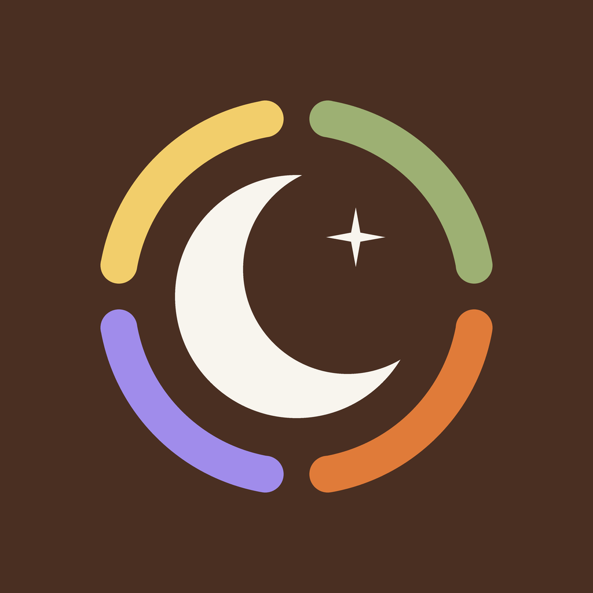
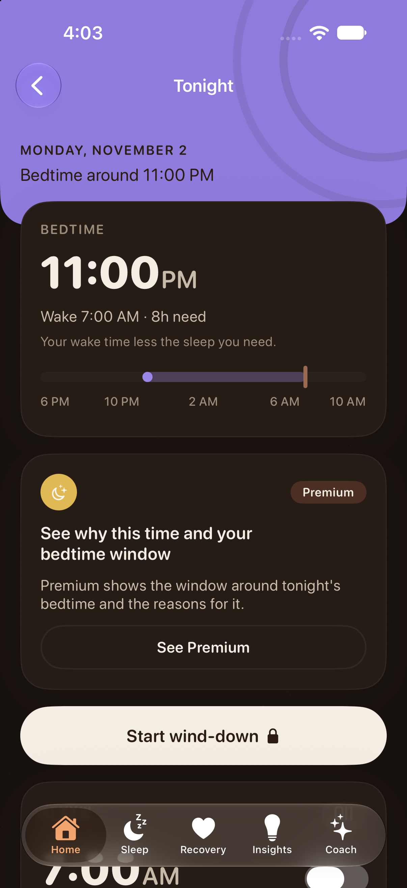
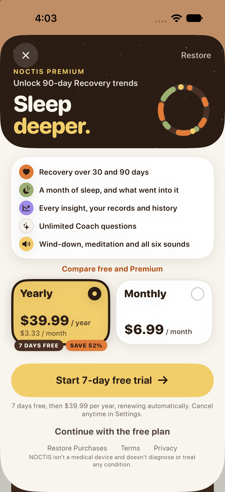
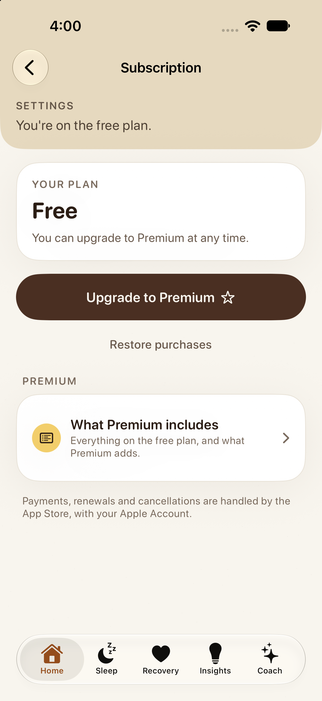

<div align="center">
  
  <h1>NOCTIS</h1>
  <p><strong>Sleep, recovery, and a softer start to tomorrow.</strong></p>
  <p>A sleep companion for iPhone and Apple Watch, built around your nights and designed with privacy in mind.</p>
  <p>
    
    
    
    <a href="LICENSE"></a>
  </p>
</div>

<p align="center">
  <a href="#screenshots">Screenshots</a> ·
  <a href="#what-it-does">What it does</a> ·
  <a href="#build-and-run">Build and run</a> ·
  <a href="#project-map">Project map</a>
</p>

## Screenshots

Sample simulator screens from the app:

<table>
  <tr>
    <td align="center"><br><sub>Tonight · bedtime plan</sub></td>
    <td align="center"><br><sub>Premium · sleep and recovery tools</sub></td>
    <td align="center"><br><sub>Settings · plan details</sub></td>
  </tr>
</table>

## What it does

NOCTIS reads sleep, heart rate, resting heart rate, heart rate variability, and respiratory rate from Apple Health. It turns those signals into a view of last night, recovery trends, and a suggested bedtime for tonight.

| **Understand your sleep** | **Plan for tonight** |
|---|---|
| Sleep summaries, recovery, and trends built from your Health data. | A bedtime window, wind-down routines, breathing, meditations, and six sleep sounds. |
| **Keep your tools close** | **Bring your own pace** |
| iPhone and Apple Watch apps, widgets, complications, Live Activities, and shortcuts. | An in-app Coach for sleep and recovery questions, plus settings to manage your data. |

> **Privacy by default.** Health access is read-only. No account is required, and the app has no third-party SDKs, advertising, or analytics service. Product events are written to the on-device system log.

## Build and run

**Requirements:** Xcode 27, iOS 26.1 or later, and watchOS 26.0 or later. The app uses Apple frameworks and has no external package dependencies.

The generated Xcode project is committed, so you can open it directly:

```bash
git clone git@github.com:Sendiw14/Noctis.git
cd Noctis
open Noctis.xcodeproj
```

Choose the **Noctis** scheme and an iPhone simulator, then build and run. To regenerate the project after changing `project.yml`:

```bash
brew install xcodegen
xcodegen generate
```

Device builds and archives need a signing team, registered bundle IDs, and the App Group configured for each target in Xcode. The identifiers and capabilities are in `project.yml` and `Config/`.

## Under the hood

The source of truth for the Xcode project is `project.yml`. App code lives in `Packages/NoctisKit` and is divided into small Swift modules:

- **Engines:** sleep analysis, recovery, bedtime recommendations, insights, breathing, sounds, coaching, and subscription rules.
- **App features:** onboarding, Home, Sleep, Recovery, Insights, Coach, Night, and Profile, built with SwiftUI.
- **Apple extensions:** widgets, Watch screens and complications, Siri intents, alarms, and Live Activities.

The engines are designed to keep calculations outside views. Views consume view-model snapshots, and missing data gets an explicit empty state. See [the app rules](Docs/APP_RULES.md) for the full set of conventions.

## Tests

Run the package suite from `Packages/NoctisKit`:

```bash
cd Packages/NoctisKit
xcodebuild test -scheme NoctisKit-Package \
  -destination 'platform=iOS Simulator,name=<an iPhone>' \
  SWIFT_EMIT_LOC_STRINGS=NO
```

The project also includes app-hosted StoreKit tests, a multi-region unit test plan, UI accessibility checks, and a release-symbol check. See [QA coverage](Docs/QA_COVERAGE.md) for the test matrix and the [release readiness report](Docs/RELEASE_READINESS.md) for current release status.

## Project map

| Path | Contents |
|---|---|
| `App/` | iPhone app entry point, assets, shortcuts, and privacy manifest |
| `Watch/`, `Widgets/` | Watch app, complications, widgets, controls, and alarm extension |
| `Packages/NoctisKit/` | Features, data layer, design system, and shared engines |
| `Tests/`, `Config/` | UI and StoreKit tests, test plan, and app capabilities |
| `Docs/` | Product rules, QA evidence, privacy notes, and release guides |
| `scripts/` | QA matrix, coverage, and release checks |

### Project notes

- [Privacy report](Docs/PRIVACY_REPORT.md)
- [Release readiness](Docs/RELEASE_READINESS.md)
- [Device test checklist](Docs/DEVICE_TEST_CHECKLIST.md)
- [Store submission checklist](Docs/store/SUBMIT_CHECKLIST.md)
- [App rules](Docs/APP_RULES.md)
- [QA coverage](Docs/QA_COVERAGE.md)

## License

NOCTIS is available under the [MIT License](LICENSE).
