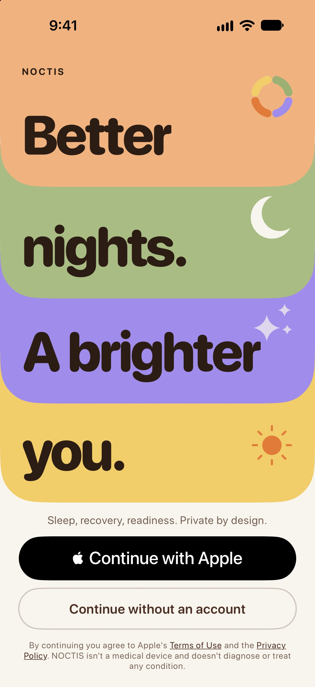
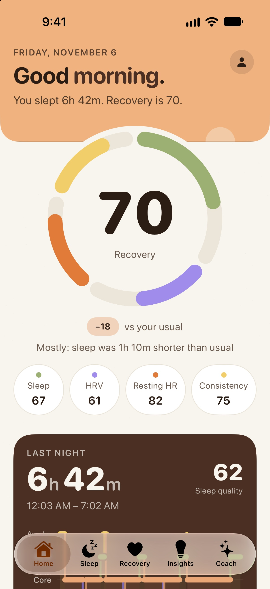
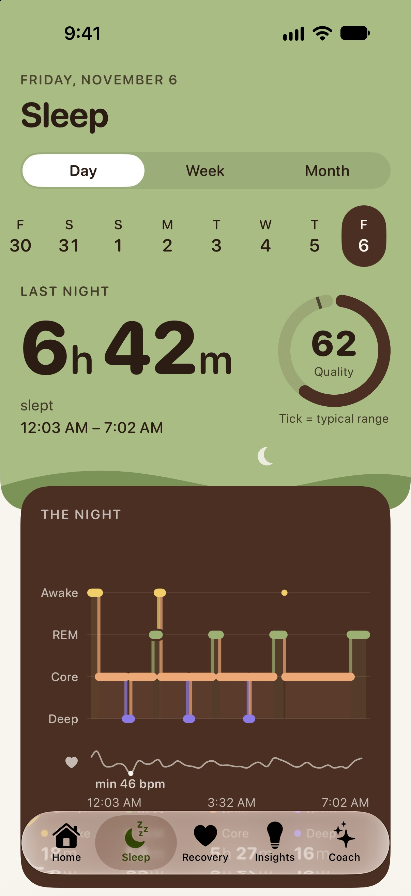
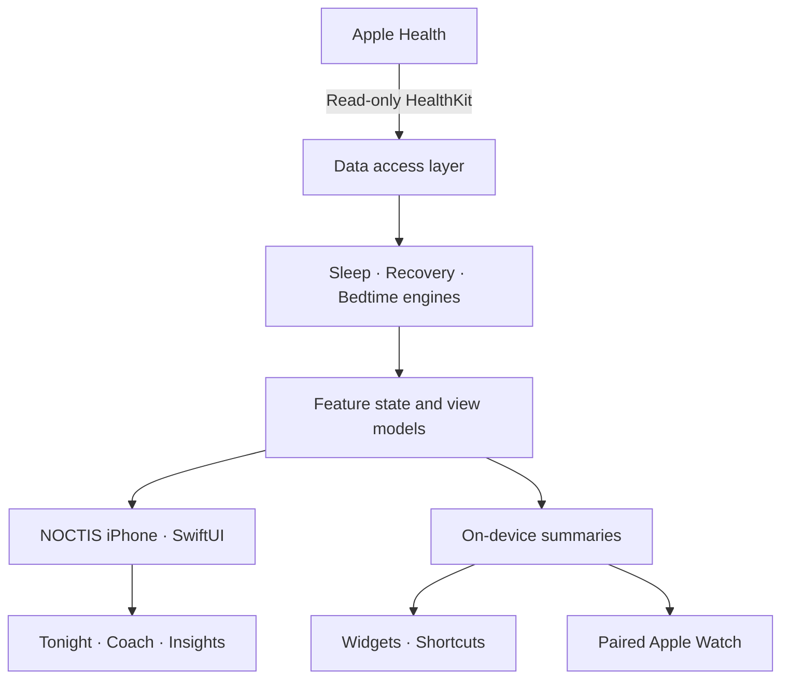

<div align="center">


# NOCTIS

### Better nights. Brighter mornings.

**A more thoughtful way to understand sleep, recovery, and the rhythm of your day.**

Native sleep and recovery companion for **iPhone + Apple Watch**. Built with SwiftUI, powered by on-device insights from Apple Health, and designed to put you in control.

<br />

<p>
  
  
  
  <a href="LICENSE"></a>
</p>

<p>
  <a href="#the-experience">Experience</a> &nbsp;·&nbsp;
  <a href="#screenshots">Screenshots</a> &nbsp;·&nbsp;
  <a href="#features">Features</a> &nbsp;·&nbsp;
  <a href="#technology">Technology</a> &nbsp;·&nbsp;
  <a href="#get-started">Get started</a> &nbsp;·&nbsp;
  <a href="#project-status">Status</a>
</p>

<sub>Designed & maintained by <a href="https://github.com/Sendiw14"><strong>Sendiw</strong></a></sub>

</div>

---

## The experience

Your nights are more than a number.

NOCTIS brings together your **sleep patterns**, **recovery signals**, and **daily routines** in one calm, considered experience. Rather than overwhelming you with charts, it helps you understand how you slept, how you might be recovering, and how to prepare for tonight.

Built around three simple moments:

| 🌙 **Reflect** | ☀️ **Understand** | ✨ **Reset** |
|:--|:--|:--|
| See the story of last night through sleep duration, stages, and patterns. | Explore recovery, trends, and the signals behind your day. | Find a suggested bedtime and a gentler wind-down routine. |

> **Privacy is part of the product, not an afterthought.** NOCTIS reads approved Apple Health data without writing to Health, and does not operate its own backend or analytics service. See [privacy details](Docs/PRIVACY_REPORT.md) for the precise data flows and Apple system services.

## Screenshots

<div align="center">
  <p><sub>Captured on an iPhone 18 Pro simulator using seeded example data.</sub></p>

  <table>
    <tr>
      <td width="33%" align="center">
        <a href="Docs/readme/onboarding-welcome.jpg">
          
        </a>
      </td>
      <td width="33%" align="center">
        <a href="Docs/readme/home-morning.jpg">
          
        </a>
      </td>
      <td width="33%" align="center">
        <a href="Docs/readme/sleep-detail.jpg">
          
        </a>
      </td>
    </tr>
    <tr>
      <td align="center"><strong>01 — Begin gently</strong><br /><sub>Welcome & onboarding</sub></td>
      <td align="center"><strong>02 — Wake informed</strong><br /><sub>Home & recovery</sub></td>
      <td align="center"><strong>03 — Know your night</strong><br /><sub>Sleep & stages</sub></td>
    </tr>
  </table>
</div>

## Features

<table>
  <tr>
    <td width="50%" valign="top">
      <h3>🌙 Sleep</h3>
      Explore last night's sleep, stage breakdowns, historical trends, and patterns from Apple Health.
    </td>
    <td width="50%" valign="top">
      <h3>◉ Recovery</h3>
      Put recovery signals in context with sleep, heart-rate-related metrics, and a more understandable daily summary.
    </td>
  </tr>
  <tr>
    <td valign="top">
      <h3>✦ Insights</h3>
      Discover useful patterns over time, with clear explanations rather than unexplained scores.
    </td>
    <td valign="top">
      <h3>☾ Tonight</h3>
      Prepare for bed with a suggested sleep window, guided breathing, meditations, and six sleep sounds.
    </td>
  </tr>
  <tr>
    <td valign="top">
      <h3>☼ Coach</h3>
      Explore in-app guidance and answers about sleep habits, recovery, and your nightly routine.
    </td>
    <td valign="top">
      <h3>⌚ Apple Watch</h3>
      Bring key information to the wrist through the companion Watch app and complications.
    </td>
  </tr>
</table>

**Beyond the main screens:** Home Screen and Lock Screen widgets, shortcuts, App Intents, an alarm experience, Live Activities, privacy controls, and subscription flows built with Apple's frameworks.

<details>
<summary><strong>More about how NOCTIS handles your data</strong></summary>

- **HealthKit access is read-only.** NOCTIS requests access to sleep, heart rate, resting heart rate, heart rate variability, and respiratory rate; availability depends on authorization and available data.
- **On-device processing.** The app calculates and caches summaries locally rather than uploading Health readings to its own server.
- **Account optional.** The core experience doesn't require a NOCTIS account. Optional Sign in with Apple is a system-mediated flow.
- **Apple ecosystem services.** StoreKit handles purchases; WatchConnectivity sends summaries to your paired Apple Watch. The precise disclosures are documented in [PRIVACY_REPORT.md](Docs/PRIVACY_REPORT.md).

</details>

## Design philosophy

NOCTIS is designed to feel like a **quiet, beautifully typeset morning ritual**.

- **Warm editorial palette:** paper, cocoa, sage, butter, lavender, and a touch of orange.
- **Clarity before complexity:** big readable numbers, meaningful hierarchy, and useful empty states.
- **Purposeful motion:** expressive transitions and feedback without making critical information depend on animation.
- **Accessibility in mind:** Dynamic Type, VoiceOver-aware presentation, and dedicated accessibility QA.

The UI is implemented with native SwiftUI, not a web view or a cross-platform shell. Read the [app design rules](Docs/APP_RULES.md) for the implementation details.

## Technology

| Layer | Technologies |
|---|---|
| Platform | **iOS 26.1+**, **watchOS 26+** |
| Language & UI | **Swift 6**, **SwiftUI** |
| Health data | **HealthKit** |
| Local state & persistence | **SwiftData**, on-device summaries, App Groups |
| Apple Watch | **WatchConnectivity**, watchOS app, complications |
| System features | **WidgetKit**, **App Intents**, **AlarmKit**, Live Activities |
| Purchases | **StoreKit** |
| Project configuration | **XcodeGen** via `project.yml` |
| Validation | **Swift Testing / XCTest**, **XCUITest**, StoreKit tests, QA scripts |

**No third-party runtime package dependencies.** The product is built with Apple frameworks and the modules included in this repository.

## Architecture

The Xcode project is generated from `project.yml`. Most application logic lives in `Packages/NoctisKit`, organized so that presentation, computation, and platform data access remain separate.



<details>
<summary><strong>Explore the repository structure</strong></summary>

```text
Noctis/
├── App/                      iPhone app, assets, privacy manifest
├── Watch/                    watchOS app and Watch features
├── Widgets/                  Home/Lock Screen and alarm extensions
├── Packages/
│   └── NoctisKit/            Shared features, engines, design system
├── Tests/                    UI tests and StoreKit scenarios
├── Config/                   Entitlements, test plans, StoreKit config
├── Docs/                     Product rules, QA evidence, release guides
├── scripts/                  Validation and release tooling
├── project.yml               XcodeGen source of truth
├── Noctis.xcodeproj/         Committed Xcode project
└── LICENSE                   MIT license
```

</details>

## Get started

### Requirements

- macOS and **Xcode 27** (the development toolchain used for the project)
- An iPhone simulator with **iOS 26.1+**
- For Watch features, **watchOS 26+** and a compatible paired simulator or device
- **XcodeGen** only if you want to regenerate the project
- An Apple development team and configured capabilities for signing to physical devices

### 1. Clone

```bash
git clone https://github.com/Sendiw14/Noctis.git
cd Noctis
```

### 2. Open the project

```bash
open Noctis.xcodeproj
```

Select the **Noctis** scheme and your iPhone simulator, then build and run from Xcode.

### 3. Regenerate the project (optional)

If you modify `project.yml` or target configuration:

```bash
brew install xcodegen
xcodegen generate
```

**Running on a physical device?** Configure the development team, bundle identifiers, App Group, and required signing capabilities for each target. See [device test checklist](Docs/DEVICE_TEST_CHECKLIST.md) and [release readiness](Docs/RELEASE_READINESS.md).

### Tests

The shared package has a test suite that can be run separately:

```bash
cd Packages/NoctisKit

xcodebuild test \
  -scheme NoctisKit-Package \
  -destination 'platform=iOS Simulator,name=<your simulator name>' \
  SWIFT_EMIT_LOC_STRINGS=NO
```

The repository also includes app-hosted purchase tests, unit test plans, UI/accessibility coverage, and release checks. Follow [QA coverage](Docs/QA_COVERAGE.md) and [release readiness](Docs/RELEASE_READINESS.md) for evidence, known findings, and what still needs verification.

## Project status

**Open-source project · Active development / pre-release.**

The [release-readiness audit dated November 1, 2026](Docs/RELEASE_READINESS.md) describes the project as ready to proceed to TestFlight, **not yet ready for App Store submission**. Outstanding items include live legal/support pages, signing and registered identifiers, real-device verification, and App Store assets. This README does not imply those steps are complete.

<sub>Sleep and recovery insights are informational and are not medical advice or a medical diagnosis.</sub>

## Documentation

| Document | Why it matters |
|---|---|
| [App rules](Docs/APP_RULES.md) | UI architecture, interaction and design principles |
| [Privacy report](Docs/PRIVACY_REPORT.md) | HealthKit permissions, processing and privacy |
| [QA coverage](Docs/QA_COVERAGE.md) | Screens, states, accessibility testing and findings |
| [Release readiness](Docs/RELEASE_READINESS.md) | Verified checks and remaining blockers |
| [Device test checklist](Docs/DEVICE_TEST_CHECKLIST.md) | Physical iPhone / Apple Watch verification |
| [Store submission checklist](Docs/store/SUBMIT_CHECKLIST.md) | App Store preparation and owner tasks |

## Creator & license

**Created and maintained by [Sendiw (@Sendiw14)](https://github.com/Sendiw14).**

NOCTIS is open source under the [MIT License](LICENSE). © 2026 Sendiw14.

---

<div align="center">

<strong>A softer start to tomorrow.</strong>

<sub>Made with SwiftUI · Designed around the way we rest.</sub>

</div>
